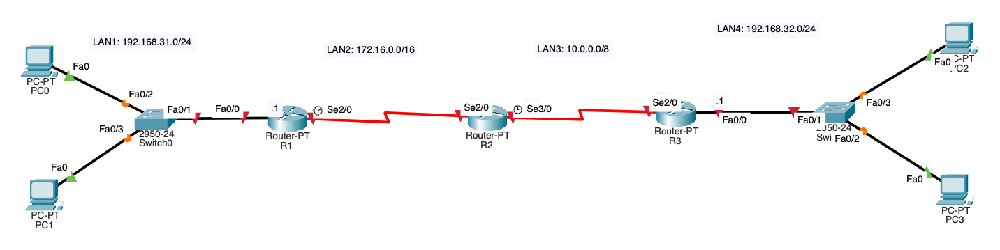
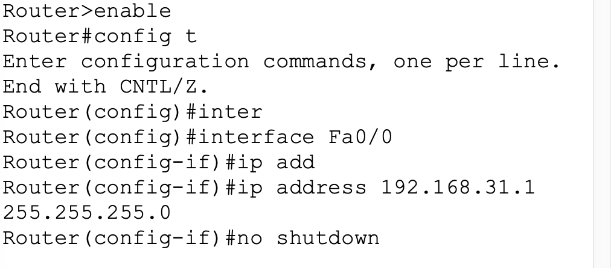

<div align="center">


**Red con tres routers: DHCP, SSH con ACL, EIGRP y NAT/PAT en Cisco Packet Tracer**


</div>

---

## 🛰️ ¿De qué va?

Práctica de la 3ª evaluación del módulo **Planificación y Administración de Redes** (1º ASIR). Monto una topología con **3 routers, 2 switches y 4 PC** y le voy añadiendo servicios paso a paso hasta que todo se comunica de extremo a extremo.

## 🗺️ Topología

<div align="center">

</div>

| Red | Dirección | Dónde |
|---|---|---|
| 🟣 LAN 1 | `192.168.31.0/24` | PC0 y PC1, detrás de R1 |
| 🔗 LAN 2 | `172.16.0.0/16` | Enlace serie R1 ↔ R2 |
| 🔗 LAN 3 | `10.0.0.0/8` | Enlace serie R2 ↔ R3 |
| 🩷 LAN 4 | `192.168.32.0/24` | PC2 y PC3, detrás de R3 |

## 🧩 Paso a paso

| Paso | Qué se configura | ✔️ |
|:-:|---|:-:|
| 1️⃣ | **Interfaces**: IPs en FastEthernet y serie, `clock rate` en los extremos DCE | ✅ |
| 2️⃣ | **DHCP**: pools en R1 (LAN 1) y R3 (LAN 4) para que los PC se configuren solos | ✅ |
| 3️⃣ | **SSH + ACL**: claves RSA en R2 y una ACL estándar en las líneas VTY que **permite a PC0 y bloquea a PC1** | ✅ |
| 4️⃣ | **EIGRP (AS 1)**: enrutamiento dinámico en los tres routers, comprobado con `show ip route` | ✅ |
| 5️⃣ | **NAT dinámico** con un pool público (`5.0.0.1 – 5.0.0.10`) en R1 | ✅ |
| 6️⃣ | **Problema y solución**: las respuestas no volvían, así que cambié a **PAT (overload)** sobre la interfaz Serial de R1 | 🛠️ |

### 🕵️ El problema del paso 6

Con NAT dinámico puro, los pings de la LAN 1 **salían pero no volvían**: los routers remotos no tenían ninguna ruta EIGRP hacia la red ficticia `5.0.0.x`. Lo solucioné con **PAT sobre la interfaz** (`172.16.0.1`), que sí está en las tablas de enrutamiento. Así conseguí conectividad completa entre todos los nodos. 🎉

> *"Una red es eficiente cuando comunica, pero es robusta cuando controla quién, cómo y cuándo se establece dicha comunicación."*

## 📸 Un vistazo a la configuración

<div align="center">

</div>

## 📂 Contenido del repositorio

```
cisco-labs/
├── practica-3-evaluacion.pkt   # Archivo de Packet Tracer
├── docs/
│   └── memoria-practica.pdf    # Memoria completa con capturas
└── img/
    ├── topologia.png
    └── captura-1.png … captura-3.png
```

## ▶️ Cómo abrirlo

Descarga `practica-3-evaluacion.pkt` y ábrelo con **Cisco Packet Tracer** (gratis con una cuenta de [Cisco Networking Academy](https://www.netacad.com/)).

---

<div align="center">

Hecho con 💜 por [Inma Villaverde](https://github.com/Inma1980)

</div>
